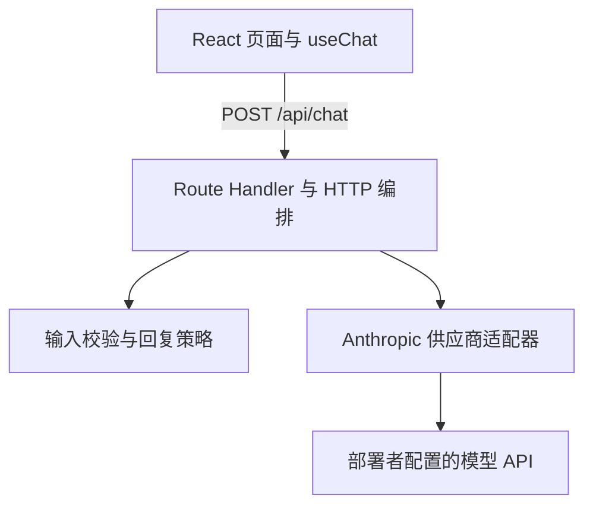

# 架构决策：模块化 BFF 与流式聊天

Personal AI Chat 使用 **Next.js App Router + React + 模块化 BFF（Backend for Frontend）**。
同一个应用提供页面与模型代理接口，浏览器通过 Fetch / Web Streams 接收 SSE；
供应商 SDK、访问控制和响应策略有各自的边界。此轮升级沿用锁文件中的依赖，没有新增运行时依赖。

## 请求经过哪些边界

HTTP 层把适配器输出的文本交给回复策略检查，再编码为浏览器协议。
模型供应商的原始事件不会直接穿透到前端；纯工具块和思考块也不会作为回答显示。

| 文件 | 负责什么 | 依赖边界 |
| --- | --- | --- |
| `app/page.js` | 模式、访问口令、消息和操作按钮的显示 | 不包含模型调用与流解析 |
| `app/hooks/use-chat.js` | 发送、取消、超时、清空与请求代次 | 调用浏览器传输层与状态 reducer |
| `lib/chat-state.mjs` | 待发送、流入、完成、失败、未完成状态 | 纯函数；旧请求动作不能影响新会话 |
| `lib/chat-client.mjs` | 完整轮次选择、UTF-8 请求预算、本地演示 | 只把成功轮次放入下一次上下文 |
| `lib/chat-transport.mjs` | Fetch 响应、增量 UTF-8 解码、SSE 帧与完成确认 | 不识别供应商事件 |
| `lib/chat-protocol.mjs` | SSE 编码与回复、数据帧上限 | 浏览器和服务端都可导入；不含密钥 |
| `app/api/chat/route.js` | Next.js GET / POST 入口 | 将 POST 交给独立 HTTP handler |
| `lib/server/chat-handler.mjs` | 配置、鉴权、请求编号、JSON/SSE 协商和资源清理 | 按请求读取环境变量；可注入供应商用于测试 |
| `lib/chat-validation.mjs` | 请求体、消息角色、字符数和令牌比较 | 仅服务端使用 |
| `lib/server/chat-service.mjs` | 回复上限、空文本、公开错误、整个回复生命周期的截止时间 | 与供应商 SDK 无关 |
| `lib/server/anthropic-provider.mjs` | SDK 调用及供应商事件到文本的转换 | 仅服务端持有 API Key |

## 为什么保留一个部署单元

当前产品是单用户、页面内存会话，业务复杂度集中在模型代理与流式交互。
模块化 BFF 让前端和接口同源部署，且可以独立测试供应商边界。服务端不依赖进程内会话表，
也不把聊天记录写到本地文件，适合现有 OpenNext / Workers 部署方式。

后续如需账号、跨设备会话或共享用量配额，应先定义数据模型与鉴权，再增加持久化服务。
更换供应商时实现 `complete(messages, { signal })` 和 `stream(messages, { signal })` 即可；
流接口返回文本异步迭代器，完整结束才允许返回，异常断流必须抛错。
目前只实现了 Anthropic 兼容适配器，未宣称支持其他供应商或多用户服务。

## 完整回复是一个明确状态

浏览器发送 `Accept: text/event-stream` 启用流；省略该请求头时保留原有 `{ content }` JSON 返回。
协议是 `start` → 零个或多个 `text-delta` → `done`，失败以 `error` 结束。
详见 [接口协议](API.zh-CN.md)。

收到文本只更新“正在回复”。服务端必须看到供应商的 `message_stop`，并确认文本非空且不超过
32,000 字符，才发送 `done`；浏览器也必须收到 `done` 才提交成功轮次。
普通连接结束、取消或错误均不能提交半截回答。页面保留部分文字并标注“未完成回复”，供用户查看和重试。

纯函数 reducer 再校验请求代次；新建会话、切换模式或卸载会使旧代次失效。
即使旧请求的回调较晚到达，也无法把内容写进新的会话。

## 截止时间、取消与背压

- 服务端请求使用 50 秒截止时间，包含收到上游响应头之后的流式读取；浏览器等待上限为 60 秒。
- 请求断开和响应体取消都会触发同一个 AbortController，取消 SDK 读取。取消后是否继续计费由实际供应商决定。
- 响应体通过 `ReadableStream.pull()` 按需读取下一段，避免先把完整答案积累后才发送。
- 流完成、失败或取消都会清理定时器和父信号监听；SDK 迭代器结束时关闭上游流。
- 服务端与浏览器都限制回复为 32,000 字符；浏览器还限制单个 SSE 帧，防止无限积累异常输入。

## 观测与验证

每次 POST 生成独立的 `X-Request-ID`。上游失败日志只保留请求编号、公开错误码和状态；
不会记录提示词、回复、令牌或 SDK 错误体。页面错误可显示请求编号，便于部署者对照日志。

`npm test` 验证字节切分、中文/emoji、CRLF、无完成事件、截止时间、取消、回复限制和旧请求隔离。
`npm run check:http` 则经过真正的生产 Next.js 服务和 SDK，使用回环地址上的模型替身：
替身先发送一段文字，直到检查明确放行才发送结尾；因此可以验证实际增量传输，且不依赖性能时间阈值。
另一项检查取消正在读取的 HTTP 响应，等待替身连接关闭，从而验证上游取消传播。

`npm run check:browser` 使用 Playwright / Chromium，经由生产服务验证页面增量显示、取消重试、
未完成回复、请求编号、清空后的新会话及 390px 手机布局。此项需要可启动浏览器的环境，
CI 会安装匹配的 Chromium，并保存使用合成会话的桌面和手机截图。

Node.js 和 Workers 构建都在 CI 中执行。线上 Workers 的代理缓冲、真实模型行为及计费，
仍需在部署环境验证；本地模型替身通过不等同于生产环境验收。

## 对照官方资料

- [Next.js：Backend for Frontend](https://nextjs.org/docs/app/guides/backend-for-frontend)
- [Next.js：Route Handlers 与 Web Streams](https://nextjs.org/docs/app/api-reference/file-conventions/route#streaming)
- [Anthropic：流式消息与终止事件](https://platform.claude.com/docs/en/build-with-claude/streaming)
- [Anthropic TypeScript SDK：流式调用与取消](https://platform.claude.com/docs/en/cli-sdks-libraries/sdks/typescript)

本项目使用锁文件中的 SDK API；官方文档可能继续更新，升级依赖时应重新执行两种构建和 HTTP 检查。
