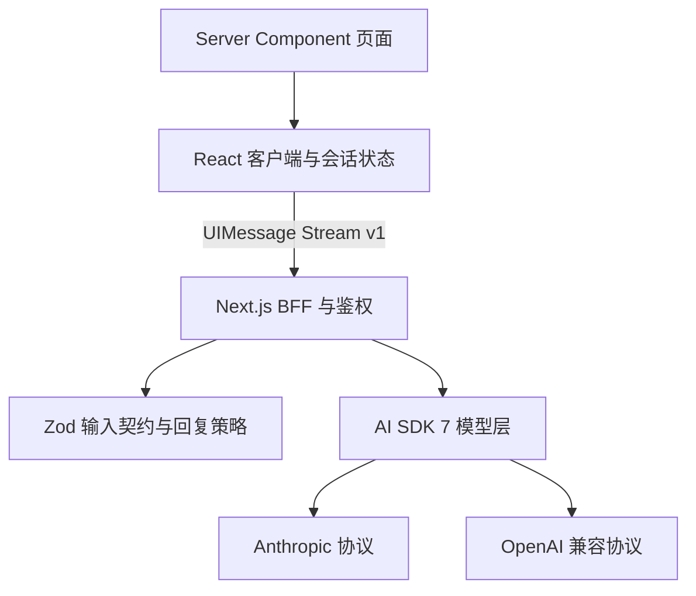

# 架构决策：类型契约、标准消息流与本机会话

当前技术版本按 **2026-11-17** 的发布状态核对：Next.js 16.4.6、React 19.3.1、
TypeScript 7.0.2、AI SDK 7.0.173、Zod 4.6.7；会话与展示使用 Dexie 4.4.7、
Streamdown 2.7.1、@streamdown/code 2.0.0、Tailwind CSS 4.3.5。精确版本由 `package-lock.json` 固定。

## 可运行的请求链路

浏览器通过 AI SDK 的 `DefaultChatTransport` 和 `readUIMessageStream` 处理标准消息流。
供应商响应由 AI SDK 归一化成文本事件，经过应用的空回复、长度与完整性策略后，才编码给浏览器。
原有 `/api/chat` JSON 与具名 SSE 继续可用，新浏览器路径为 `/api/chat/ui`。

| 文件 | 负责什么 |
| --- | --- |
| `app/page.tsx`、`app/layout.tsx` | Server Component 页面边界、文档元数据和全局样式 |
| `app/components/chat-app.tsx` | 模式、访问口令和消息展示；浏览器存储留在客户端 |
| `app/hooks/use-chat.ts`、`lib/chat-state.ts` | 请求代次、取消、完成/失败状态与清空隔离 |
| `app/hooks/use-conversation-history.ts`、`app/components/conversation-history.tsx` | 主动保存、响应式目录、查找与打开；异步存储操作不能重选新会话 |
| `lib/local/conversation-store.ts` | IndexedDB 双表事务、Zod 读写验证、修订号、大小限制与导出 |
| `app/components/message-markdown.tsx` | Streamdown 增量 Markdown、Shiki 代码块；链接协议与外部图片边界 |
| `lib/chat-contract.ts` | Zod Schema、推导类型、文本/标准 UI 消息转换与共同上限 |
| `lib/text-boundaries.ts` | Unicode 完整性、流式代理项缓冲与完整字素标题截断 |
| `lib/chat-client.ts` | 完整轮次裁剪；按实际 UI 信封计算 UTF-8 字节预算 |
| `lib/chat-ui-transport.ts` | 官方 AI SDK 传输/读取器；验证请求元数据、完成事件和帧预算 |
| `lib/chat-transport.ts`、`lib/chat-protocol.ts` | 兼容旧 JSON / 具名 SSE 的读取与编码 |
| `app/api/chat/route.ts`、`app/api/chat/ui/route.ts` | 动态配置状态、兼容接口与标准消息流接口 |
| `lib/server/chat-handler.ts` | 同一套鉴权、输入校验、请求编号、回复策略及两种流编码 |
| `lib/chat-validation.ts`、`lib/server/chat-service.ts` | 实际读取字节限制、令牌比较、回复上限、公开错误与截止时间 |
| `lib/server/model-provider.ts` | 显式模型实例；配置解析、两种供应商适配、AI SDK generateText / streamText |

## 类型约束进入运行与 CI

生产页面、Hook、协议和服务端源码均为 TypeScript。`strict`、`noUncheckedIndexedAccess`、
`erasableSyntaxOnly` 开启，`allowJs` 关闭；CI 在构建前独立执行 `npm run typecheck`。
Node.js 22.18+ 可直接执行可擦除的 `.ts` 模块，测试和 Next.js 构建使用相同源码。

共享 Zod Schema 同时产生 TypeScript 类型并验证实际输入。标准 UI 接口仅接受 user / assistant
文本 parts；system、工具、文件和额外可执行字段不能被静默提升为模型上下文。
UI 信封的 ID、parts 和转义开销也计入 64 KiB 请求预算。

React Compiler 通过 `next.config.ts` 开启，参与实际生产与 Workers 构建。
Server Component 外壳与客户端交互组件分别维护；浏览器存储和请求生命周期均留在客户端。
性能变化尚未进行基准测量。

## 模型层显式选择供应商

`CHAT_PROVIDER` 仅由部署环境设置，支持 `anthropic` 和 `openai-compatible`。
默认保留原来的 `CLAUDE_MODEL` / `ANTHROPIC_*` 配置；Anthropic 基址统一为带 `/v1` 的地址，
已经包含 `/v1` 时不重复追加。OpenAI 兼容服务填写实际 Chat Completions API 基址及模型 ID。

两种适配器通过 AI SDK 7 的同一接口生成文本。使用 provider 实例，避免裸模型字符串自动走 AI Gateway。
浏览器不能选择密钥、上游地址或模型。HTTP 请求重试和流内重试都设为零，失败由用户显式重试。
第三方兼容网关的模型能力仍需在对应服务核对；本项目没有宣称所有网关完全兼容。

## 完成、取消与资源生命周期

标准协议是 `start`、`text-start`、`text-delta`、`text-end`、`finish`；尾部 `[DONE]` 是 SSE
传输终止标记。应用必须收到有效 `finish` 且文本非空，才把本轮标为成功；仅有 `[DONE]` 或 EOF 不足以提交。
上游 SDK 报告 `interrupted`、错误或缺失终止原因时，半截文字仍以“未完成回复”留在页面。
旧协议的成功标记为 `done`，两种编码共享同一回复策略。

服务端先读取到上游首个文本或终止事件，再建立流，以便在开流前保留上游 401 / 429 对应的公开 HTTP 状态。
响应按 `ReadableStream.pull()` 读取经过校验的下一段。取消不创建后台消费副本，直接通过信号和迭代器清理传播到模型连接。

- 服务端截止时间为 50 秒，覆盖请求体读取和上游流式回复；浏览器等待上限为 60 秒。
- 服务端与浏览器均限制回复为 32,000 字符；标准流的单帧字节在 SDK 解析前受限。
- 完成、失败、取消均释放定时器和父信号监听；模型迭代器退出时中止剩余读取。
- 页面纯函数 reducer 和递增请求代次同时隔离旧回调，新会话不会接收旧文字。
- 取消传播到实际供应商后是否停止计费，仍由供应商决定。

## 本机存储与 Markdown 展示

会话只在用户点击保存后写入 IndexedDB。摘要与消息体分表，目录只查询摘要；
一次事务提交两者，任一写入失败都会回滚。更新和删除在同一事务中比较修订号，
不让旧标签页覆盖新记录，也不让已删除记录被旧更新复活。
Dexie live query 让已打开的目录跟随其他标签页的成功写入更新。

打开会话前先完整读取和校验，再取消旧请求并替换显示状态。恢复的消息去掉内部请求标识，
pending / streaming 状态降级为 failed / incomplete，不会被拼入成功模型上下文。
存储 Hook 有独立操作代次，保存过程中“新建会话”会使旧回调失效。

Streamdown 处理尚未闭合的代码块，Shiki 负责语法高亮；流式阶段禁用代码复制，
完成后复制原始代码文本。保留默认净化流程，链接只允许 HTTP / HTTPS / mailto，
并显式设置新窗口隔离；图片显示替代文字，避免模型回复自动加载外部追踪资源。
回复组件通过客户端动态导入加载：初始服务器页面没有历史消息，不把高亮依赖纳入服务器渲染路径。
Tailwind 4 只导入 theme / utilities，不引入 Preflight，原页面 reset 放入 base layer。
详细边界与验证见[本机会话说明](LOCAL_CONVERSATIONS.zh-CN.md)。

## 验证与当前边界

`npm test` 覆盖标准/兼容消息流、错误、终止、取消、Schema、上下文预算和会话状态，
并用 fake-indexeddb 执行实际 Dexie 事务，验证回滚、修订冲突、并发与存储数据校验。
`npm run check:http` 的 41 项检查经过生产 Next.js、AI SDK 和回环地址的模型替身；
Anthropic、OpenAI 兼容两种协议分别验证鉴权和连接关闭。首段文字必须在检查放行上游结尾前到达，
避免把一次性完整输出误当成增量流。

`npm run check:browser` 用 Chromium 验证标准协议的实际页面交互、取消重试、未完成回复、
清空后立即发送、保存/刷新/跨标签页、Markdown 代码复制和 390px 手机布局。
Node.js 和 Workers 构建、依赖审计同样进入 CI。
请求失败日志只保存请求编号、公开错误码和状态，不保存提示词、回复、密钥或 SDK 错误体。
`check:text` 扫描源码和文档的 UTF-8 字节与高置信乱码特征；请求、流式回复、标题与本机存储的
Unicode 边界见[检查记录与设计](TEXT_BOUNDARIES.zh-CN.md)。

当前是单用户应用，页面会话可主动保存到本浏览器。多用户账号、服务端会话库、
跨设备同步、工具执行、RAG 和跨请求续传尚未实现。
真实模型与线上 Workers 的运行行为需在实际部署环境验收，本地替身检查不等于生产模型验收。

## 官方资料

- [Next.js 16.4 与 React 19.3](https://nextjs.org/blog/next-16-4)
- [React Compiler 配置](https://nextjs.org/docs/app/api-reference/config/next-config-js/reactCompiler)
- [AI SDK 7](https://ai-sdk.dev/docs/introduction)
- [标准传输](https://ai-sdk.dev/docs/ai-sdk-ui/transport)与[UIMessage 读取器](https://ai-sdk.dev/docs/ai-sdk-ui/reading-ui-message-streams)
- [Anthropic provider](https://ai-sdk.dev/providers/ai-sdk-providers/anthropic)与[OpenAI 兼容 provider](https://ai-sdk.dev/providers/openai-compatible-providers)
- [Dexie 事务](https://dexie.org/docs/Dexie/Dexie.transaction())与[React live query](https://dexie.org/docs/dexie-react-hooks/useLiveQuery())
- [Streamdown](https://streamdown.ai/docs)、[代码插件](https://streamdown.ai/docs/plugins/code)与[Tailwind Preflight](https://tailwindcss.com/docs/preflight)
